<p align="center"></p>
<h1 align="center">Pocket Notes</h1>
<p align="center">Self-hosted Markdown notes kept as plain files where you choose — on the server, in your Nextcloud or Pocket Files, on any WebDAV server or in a folder.<br>One Go binary, one SQLite file, one volume.</p>
<p align="center">
  <a href="https://github.com/abjelosevic88/pocket-homelab-notes/actions"></a>
  <a href="https://github.com/abjelosevic88/pocket-homelab-notes/pkgs/container/pocket-homelab-notes"></a>
  <a href="LICENSE"></a>
</p>

---

Pocket Notes is a notes server that does what Nextcloud Notes does and a good deal more: full-text
search, tags, links between notes with backlinks, every checkbox gathered into one task list, daily
notes with quick capture, a version history of every change from any device, a trash, public
read-only links, and a rich editor whose `/` menu reaches into the rest of the homelab (photos from
Immich, documents from Pocket Documents, issues from Forgejo, the server's state, the week's viewing,
spending, the car's log…).

The notes stay ordinary `.md` files in folders. Point it at the folder Nextcloud Notes uses and both
see the same notes — and because Pocket Notes also speaks Nextcloud Notes' own API, the Nextcloud
Notes apps and the Pocket Homelab app work against it too.

<p align="center">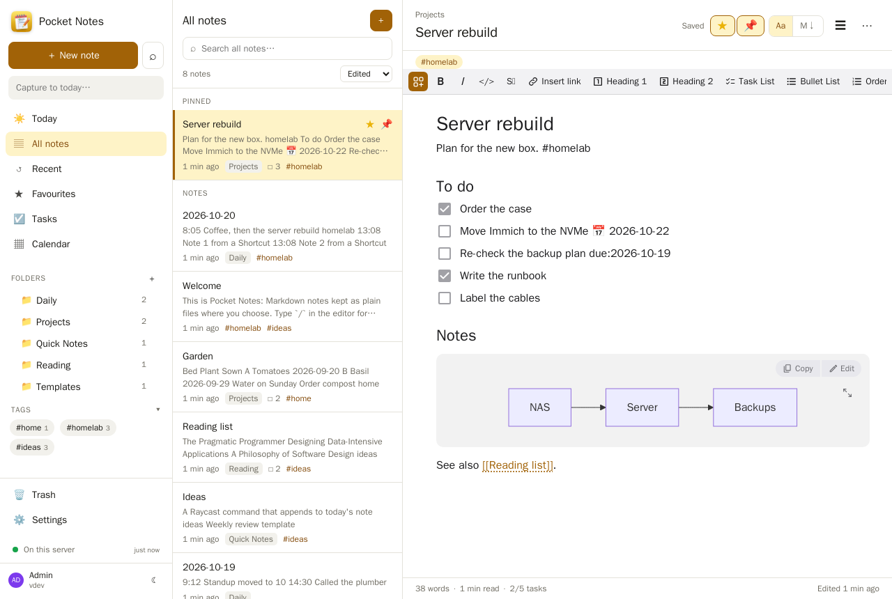</p>

## Screenshots

<table>
  <tr>
    <td width="50%">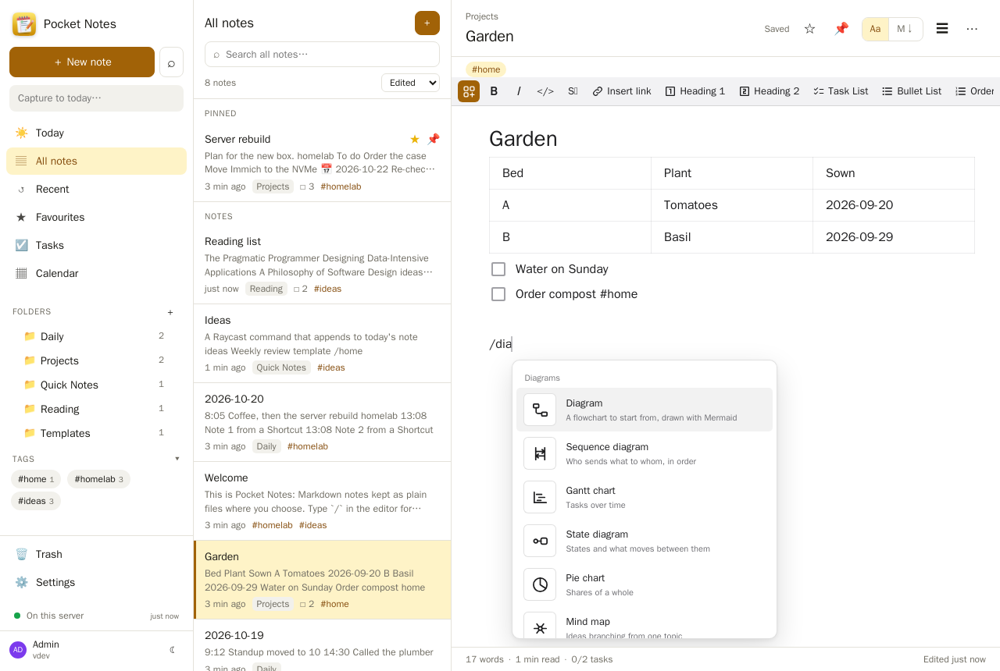</td>
    <td width="50%">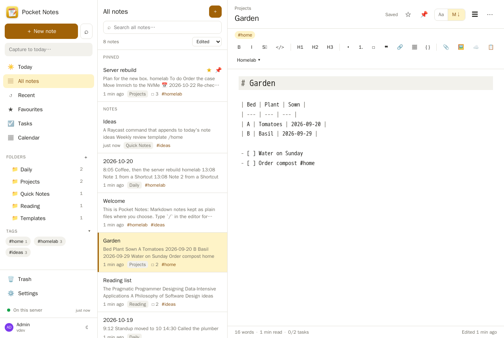</td>
  </tr>
  <tr>
    <td width="50%">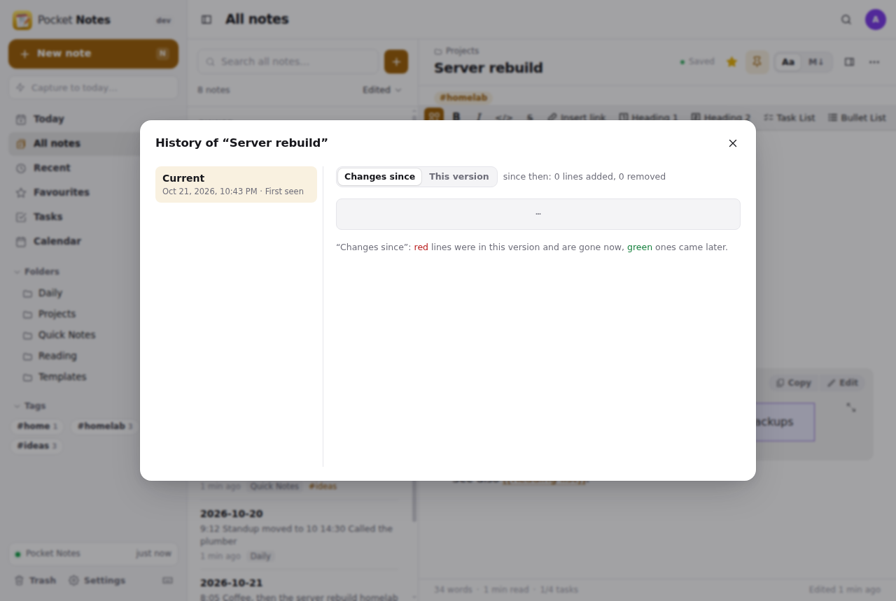</td>
    <td width="50%">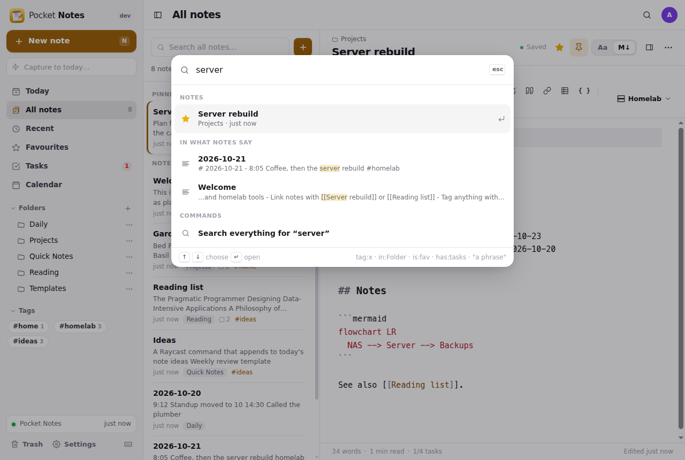</td>
  </tr>
  <tr>
    <td width="50%">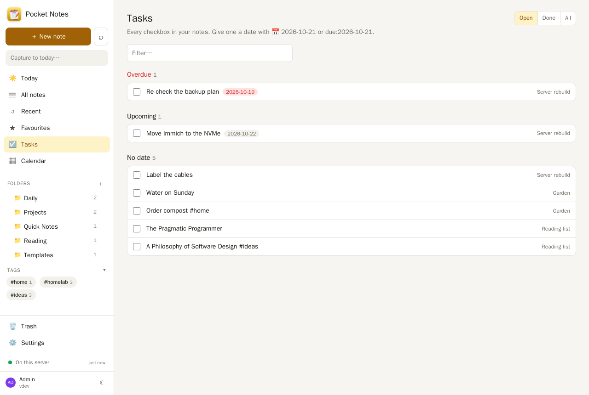</td>
    <td width="50%">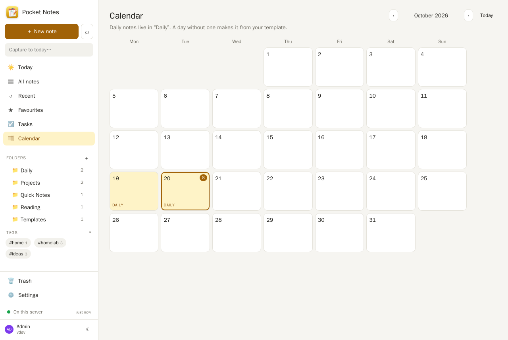</td>
  </tr>
  <tr>
    <td width="50%">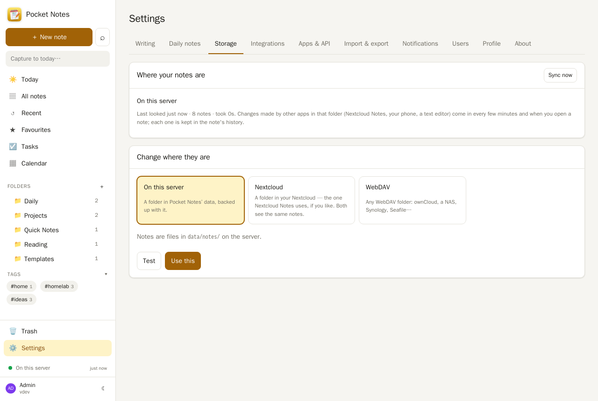</td>
    <td width="50%">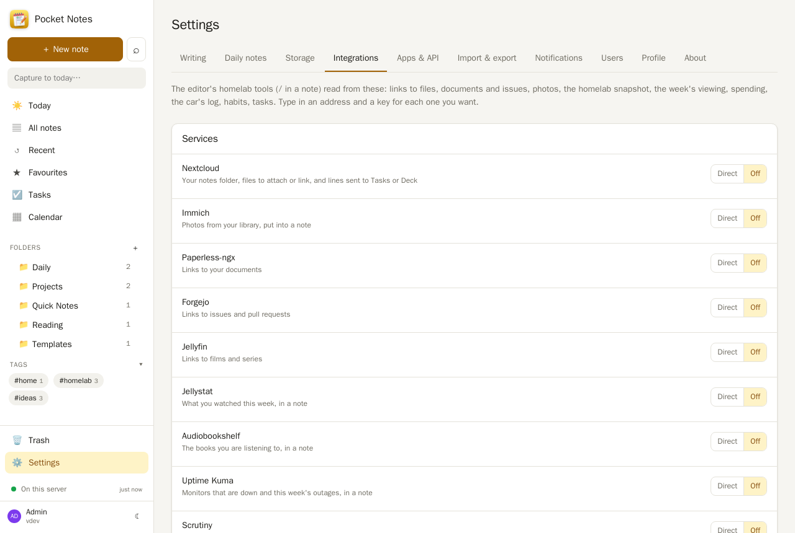</td>
  </tr>
</table>
<p align="center">
  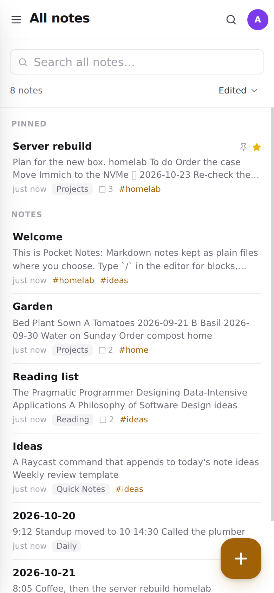&nbsp;&nbsp;
  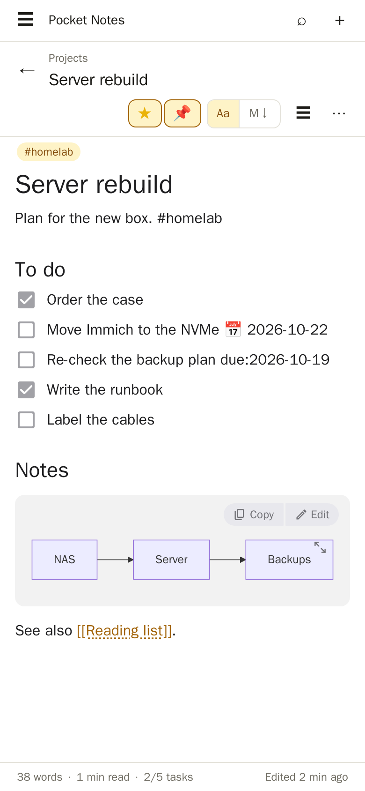&nbsp;&nbsp;
  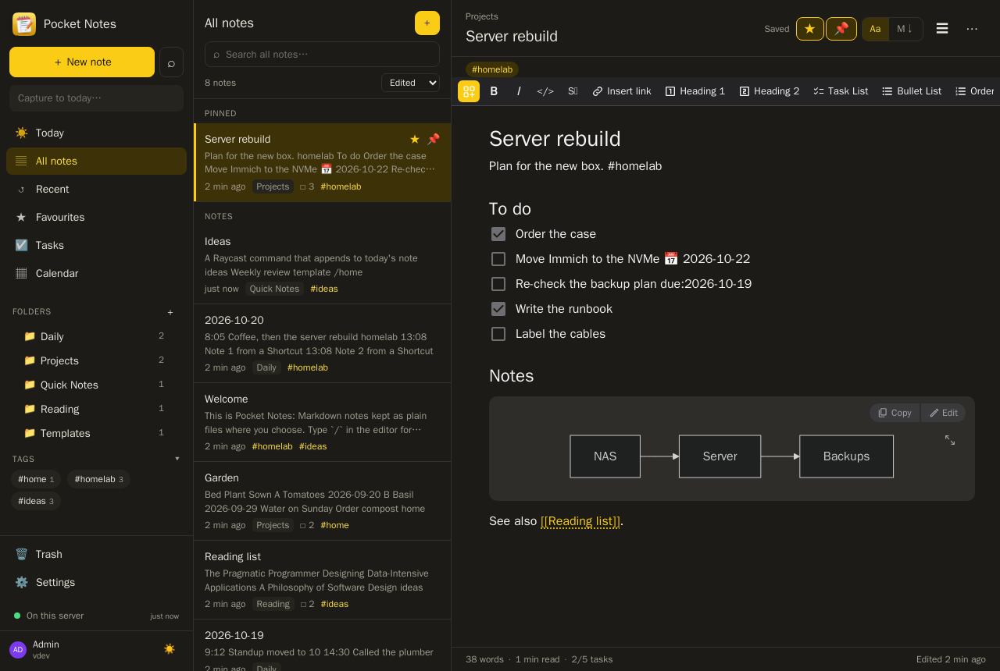
</p>

## What it does

**Your notes, your files**
- Each person chooses where their notes live: a folder on this server, a folder in **Nextcloud**
  (through Pocket Core, nothing to type), a folder in **Pocket Files** (through Pocket Core, a
  short-lived link token as the WebDAV password), any **WebDAV** server, or a folder on the server
  (`STORAGE_ROOTS`). Moving copies everything over, or starts from what is already there.
- Changes made elsewhere — Nextcloud Notes, a phone, Obsidian, a text editor — come in on their own;
  renamed files keep their history; deleted ones land in the trash with their text.
- A save never overwrites somebody else's edit: you see *Changed somewhere else* and choose.
- Note ids are Nextcloud's file ids when the notes live there, so links and apps keep working.

**Writing**
- The rich editor of the Pocket Homelab app (Milkdown): edit as it reads; `/` for headings, lists,
  tasks, tables, code in 20 languages, callouts, collapsible sections, Mermaid diagrams, formulas,
  footnotes, a table of contents, emoji, dates (`@today`), templates.
- Or the plain **Markdown** source (CodeMirror), one click away, for every note.
- `[[` links a note; `[[Title]]` written by hand works too. Backlinks and unlinked mentions per note.
- `#tags` anywhere (and in front matter); folders as deep as you like.
- Pictures and files pasted, dropped or uploaded are stored with the note.
- Title follows the first line, as in Nextcloud Notes (or not — your choice).

**Homelab tools** in the `/` menu (each shown when its service is connected)
- *Link to something*: Nextcloud files (full-text), people in Pocket Contacts, Pocket Documents (full text and
  OCR), Forgejo issues and pull requests, Jellyfin titles, Immich photos — the note gets a link, not a copy.
- *@ and a name* while typing: the people in Pocket Contacts whose names match; the one picked becomes a link to
  their page there, which lists the note.
- *From Photos* (Immich, smart search) and *From Nextcloud*: put pictures and files into a note.
- *Make this line a task* (Nextcloud Tasks or Deck) and *Make this line a transaction* (Pocket
  Money): the line stays, with a link to where it went.
- Blocks written from what the services know: homelab snapshot, what needs attention (Kuma,
  Scrutiny, Backrest), watched and listened this week (Jellystat, Pocket Podcasts, Audiobookshelf),
  spending this month (Pocket Money), the vehicle log (Pocket Garage), hosts on the network
  (AdGuard), server processes (Glances), days of habits (Pocket Habits).
- Web bookmark with the page's title, a voice memo (with its words, where the browser can), a photo.

**Finding and keeping**
- Full-text search (SQLite FTS5, accents folded) with `tag:`, `in:`, `is:fav`, `has:tasks`, `"phrases"`.
  ⌘K finds by title as you type.
- **Tasks**: every checkbox in every note, overdue / today / upcoming (`📅 2026-10-21` or `due:`), tick
  them from the list.
- **Daily notes** in your own folder, title format and template; a calendar of them; **capture**
  to today's note from the sidebar, a Shortcut, Raycast or `curl`.
- **History**: every saved state, from any device, with a diff and restore. **Trash** for 30 days.
- Favourites (Nextcloud's star, both ways), pins, recent, sort by edited / created / title.
- **Share** a note as a read-only public link, with an end date if you like. Print / PDF, standalone
  HTML, `.md`, or the whole folder as a zip. Import Markdown files or a zip (Obsidian, Bear, Joplin).

**The rest**
- **Nextcloud Notes API** (v0.2 and v1, attachments, unified search, the WebDAV the apps use): the
  Nextcloud Notes apps and the Pocket Homelab app work against Pocket Notes as they are.
- Every person has their own notes, storage and settings; admins see no one else's.
- Pocket Core: "Sign in with Pocket Core", each person's own service accounts for the integrations,
  app links for Pocket Habits / Money / Garage / Podcasts / Documents, `notes.created/updated/deleted` events,
  and `notes:read` / `notes:write` for other Pocket apps.
- `GET /api/v1/dashboard` for Homepage, Prometheus `/metrics`, API tokens, dark mode, a PWA.

## Run it

```yaml
services:
  pocket-notes:
    image: ghcr.io/abjelosevic88/pocket-homelab-notes:latest
    restart: unless-stopped
    ports: ["8080:8080"]
    environment:
      TZ: Europe/Berlin
      BASE_URL: https://notes.example.com
      SECURE_COOKIES: "true"
    volumes:
      - ./data:/data
```

Open it, create the first account, then **Settings → Storage** to choose where your notes live.
To keep using Nextcloud Notes alongside, choose Nextcloud and the folder Nextcloud Notes uses
(Nextcloud Notes → Settings shows it, `Notes` unless you changed it).

To use a Nextcloud Notes app with it: server = this address, username = your email, password = an
API token from Settings → Apps & API.

## Docs

- [Configuration](docs/configuration.md) — every environment variable
- [Where notes live](docs/storage.md) — storage kinds, sync, conflicts, moving, ids
- [Nextcloud Notes compatibility](docs/nextcloud-notes-api.md)
- [HTTP API](docs/api.md) — notes, search, tasks, capture, Shortcuts
- [Backup](docs/backup.md)
- [Roadmap](docs/roadmap.md)

## Develop

```sh
make web          # build the UI (web/ → web/dist, embedded in the binary)
make run          # demo data, no login, http://localhost:8080
make test         # go vet + go test + tsc
```

The rich editor lives in `web/src/editor` (it is the Pocket Homelab app's editor, running in a frame
of the page as it runs in a web view there); the page talks to it in `web/src/components/RichEditor.tsx`.

MIT licensed.
